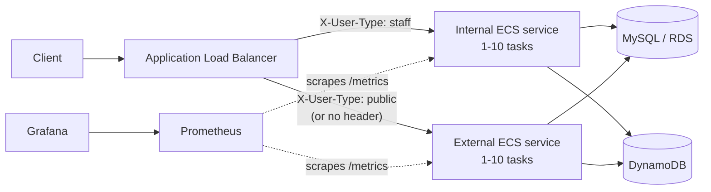

# Gospital

A scalable hospital management system API written in Go with MySQL and DynamoDB backends for optimized healthcare data management.

## Introduction

Healthcare API failures directly impact patient safety:

- Inaccessible medical records delay treatment decisions
- Appointment outages prevent patients from receiving care
- Billing downtime disrupts hospital operations

Using a hybrid database architecture (MySQL + DynamoDB) improves performance but introduces new failure modes. Gospital addresses these challenges through circuit breakers, bulkhead isolation, request timeouts, and auto-scaling.

## Tech Stack

| Layer | Technology |
|---|---|
| API | Go 1.25, Gin, Swagger (swaggo) |
| Data | MySQL 8.0 (Amazon RDS), Amazon DynamoDB |
| Resilience | sony/gobreaker, custom timeout and CPU load-shedding middleware |
| Infrastructure | Docker, AWS ECS Fargate, Application Load Balancer, Cloud Map, Terraform |
| Observability | Prometheus, Grafana |
| Load testing | Locust |

## Architecture



### Hybrid data model

Data is split between two stores by access pattern:

- **MySQL** holds relational data that needs joins and constraints: patients, doctors, departments, and appointments. List endpoints use `LIMIT`/`OFFSET` pagination.
- **DynamoDB** holds document-shaped, append-heavy data: medical records and invoices. Each table has a `PatientIdIndex` global secondary index (partition key `patientId`, sort key `visitDate` or `invoiceDate`), so a patient's history is a single `Query` returned newest first, with no table scans.

All IDs are prefixed [ULIDs](https://github.com/ulid/spec) (`PAT-`, `DOC-`, `APT-`, `REC-`, `INV-`). They are generated in the application, sortable by creation time, and safe to create concurrently across tasks without coordinating through the database.

The code is layered as `handlers → services → repositories → infrastructure`. Handlers translate HTTP, services hold business rules (for example, rejecting an appointment that overlaps an existing one for the same doctor), and repositories are the only layer that talks to a database.

## Resilience Design

Every request under `/api` passes through this middleware chain, and every database call goes through a circuit breaker:

```
Request → Prometheus metrics → 100 ms timeout → CPU load shedding → handler → service → repository → circuit breaker → MySQL / DynamoDB
```

### 1. Database circuit breakers

`internal/infrastructure/mysql_client.go` and `dynamodb_client.go` wrap the database clients so that every query, exec, get, put, update, and scan runs inside a [`gobreaker`](https://github.com/sony/gobreaker) circuit breaker. MySQL and DynamoDB each have their own breaker, so an outage in one store does not block requests that only need the other.

| Setting | Value | Meaning |
|---|---|---|
| Trip condition | ≥ 60% failures with at least 3 requests | Opens on a sustained failure rate, not on a single error |
| Counting window | 10 s | Failure counts reset every 10 s while closed |
| Open duration | 30 s | Requests fail immediately instead of waiting on a broken database |
| Half-open probes | 3 requests | A few trial requests decide whether to close again |

Every state change is logged and exported as the `mysql_circuit_breaker_state` and `dynamodb_circuit_breaker_state` metrics.

### 2. Request timeout

`internal/middleware/timeout.go` gives each API request a **100 ms** budget. A request that runs longer returns `504 REQUEST_TIMEOUT` instead of tying up the connection. A panic inside the handler is passed back to Gin's recovery middleware rather than being lost. Rejections are counted in `timeout_rejections_total`.

### 3. CPU-based load shedding

`internal/middleware/cpu_circuit_breaker.go` sheds load before a task becomes unresponsive:

- A background goroutine polls the **ECS task metadata endpoint** every 100 ms. It computes container CPU usage from cumulative CPU-time deltas and divides by the task's vCPU limit.
- When CPU reaches **95%**, new requests get `503 SERVICE_OVERLOADED` immediately.
- Normal service resumes once CPU drops below **85%**. The gap between the two thresholds (hysteresis) stops the breaker from flapping open and closed around a single value.
- When the service runs outside ECS (for example, locally), the metadata endpoint is missing and the breaker stays disabled.

### 4. Bulkhead isolation

Staff and public traffic run on **separate ECS services** built from the same image. The ALB routes on the `X-User-Type` header: `staff` goes to the internal service, while `public` or no header goes to the external service. A spike in public patient-portal traffic can exhaust only the external service's CPU and tasks, so staff workflows keep their own capacity.

### 5. Auto-scaling

Each service scales independently between **1 and 10 Fargate tasks** (0.25 vCPU / 512 MB each). It uses target tracking on average CPU (target 50%) and memory (target 80%), with a 60 s scale-out cooldown and a 180 s scale-in cooldown.

## Observability

`GET /metrics` exposes Prometheus metrics:

- **HTTP:** `http_requests_total`, `http_request_duration_seconds` (histogram, 5 ms – 10 s buckets), `http_requests_in_flight`
- **Resilience:** circuit breaker state for MySQL, DynamoDB, and CPU; `cpu_usage_percent`; `cpu_circuit_breaker_rejections_total`; `timeout_rejections_total`
- **MySQL pool:** open, in-use, and idle connections; wait count; wait duration
- **Go runtime:** goroutines, heap, and GC pauses

Prometheus runs on ECS, finds the API tasks through AWS Cloud Map service discovery, and scrapes them every 15 s. `scripts/dashboard.json` is a Grafana dashboard for these metrics.

## Running Locally

You only need Docker and Go. MySQL and DynamoDB run in containers, so no AWS account is required.

```bash
# 1. Start MySQL (loads the schema and seed departments) and DynamoDB Local
docker run -d --name gospital-mysql -e MYSQL_ROOT_PASSWORD=localpass -e MYSQL_DATABASE=gospital \
  -p 3307:3306 -v "$PWD/scripts/init.sql:/docker-entrypoint-initdb.d/init.sql:ro" mysql:8.0
docker run -d --name gospital-dynamo -p 8001:8000 amazon/dynamodb-local -jar DynamoDBLocal.jar -inMemory -sharedDb

# 2. Create the DynamoDB tables (requires the AWS CLI; credentials can be any value for DynamoDB Local)
export AWS_ACCESS_KEY_ID=local AWS_SECRET_ACCESS_KEY=local AWS_REGION=us-east-1
for spec in "medical-records recordId visitDate" "invoices invoiceId invoiceDate"; do
  set -- $spec
  aws dynamodb create-table --endpoint-url http://localhost:8001 --table-name "$1" \
    --billing-mode PAY_PER_REQUEST \
    --attribute-definitions AttributeName="$2",AttributeType=S AttributeName=patientId,AttributeType=S AttributeName="$3",AttributeType=S \
    --key-schema AttributeName="$2",KeyType=HASH \
    --global-secondary-indexes "IndexName=PatientIdIndex,KeySchema=[{AttributeName=patientId,KeyType=HASH},{AttributeName=$3,KeyType=RANGE}],Projection={ProjectionType=ALL}"
done

# 3. Generate the Swagger docs and start the API
go install github.com/swaggo/swag/cmd/swag@v1.16.6
swag init -g cmd/api/main.go -o docs

AWS_ENDPOINT_URL_DYNAMODB=http://localhost:8001 \
MYSQL_DSN='root:localpass@tcp(localhost:3307)/gospital?parseTime=true' \
DYNAMODB_REGION=us-east-1 MEDICAL_RECORDS_TABLE=medical-records INVOICES_TABLE=invoices \
SERVER_PORT=8080 go run ./cmd/api
```

The step 2 loop uses bash word splitting. In zsh, run it with `bash -c` or create the two tables one at a time.

Then open:

- Swagger UI: http://localhost:8080/swagger/index.html
- Health check: http://localhost:8080/health, which reports MySQL and DynamoDB status
- Metrics: http://localhost:8080/metrics

Clean up with `docker rm -f gospital-mysql gospital-dynamo`.

## Deploying to AWS

The `terraform/` directory provisions the full stack: VPC, ALB, two ECS services, RDS MySQL, DynamoDB tables, ECR, Prometheus, and Grafana. Terraform builds the Docker image and initializes the database schema from `scripts/init.sql`. Common tasks are wrapped in the Makefile:

```bash
make deploy    # provision infrastructure and deploy
make update    # rebuild the image and roll both ECS services
make status    # show deployment status
make destroy   # tear everything down
```

> **Note:** `terraform/variables.tf` ships with demo defaults (for example, the RDS password), and Grafana allows anonymous admin access. Override these before any real deployment.

## Load Testing

`load_test/` contains two Locust scenarios:

| Script | What it tests |
|---|---|
| `locustfile_bulkhead.py` | Runs identical workloads as `staff` and `public` users to compare the two services side by side, covering bulkhead isolation, auto-scaling, and CPU load shedding |
| `locustfile_database.py` | Exercises the MySQL and DynamoDB circuit breakers, connection-pool exhaustion (with the pool reduced to 5), and recovery |

```bash
pip install locust
locust -f load_test/locustfile_bulkhead.py --host=http://<alb-dns> --users=200 --spawn-rate=10
```

## Results

These results come from the project's experiments. Some were measured on an earlier iteration whose configuration differed from the current code, so read them as preliminary.

| Experiment | Result |
|---|---|
| Healthy-state throughput | 200 req/s with p95 latency under 100 ms |
| Capacity limit without isolation | MySQL connection-pool exhaustion above 300 req/s |
| Failure detection (circuit breaker vs. timeout) | 62 ms vs. 3,200 ms average, about 51x faster. Measured with an earlier 3 s database timeout. |

## Project Structure

```
gospital/
├── cmd/
│   └── api/
│       ├── main.go                 # Application entry point
│       └── router.go               # HTTP router setup
├── internal/
│   ├── handlers/                   # HTTP request handlers
│   │   ├── appointment_handler.go
│   │   ├── department_handler.go
│   │   ├── doctor_handler.go
│   │   ├── invoice_handler.go
│   │   ├── medical_record_handler.go
│   │   ├── patient_handler.go
│   │   └── root_handler.go
│   ├── infrastructure/             # Database clients with circuit breakers
│   │   ├── dynamodb_client.go
│   │   ├── metrics.go
│   │   └── mysql_client.go
│   ├── middleware/                 # HTTP middleware
│   │   ├── cpu_circuit_breaker.go
│   │   ├── prometheus.go
│   │   └── timeout.go
│   ├── models/                     # Data models
│   │   ├── appointment.go
│   │   ├── department.go
│   │   ├── doctor.go
│   │   ├── error.go
│   │   ├── invoice.go
│   │   ├── medical_record.go
│   │   ├── pagination.go
│   │   ├── patient.go
│   │   └── timeslot.go
│   ├── repository/                 # Data access layer
│   │   ├── appointment_repository.go
│   │   ├── department_repository.go
│   │   ├── doctor_repository.go
│   │   ├── invoice_repository.go
│   │   ├── medical_record_repository.go
│   │   └── patient_repository.go
│   └── services/                   # Business logic layer
│       ├── appointment_service.go
│       ├── department_service.go
│       ├── doctor_service.go
│       ├── errors.go
│       ├── invoice_service.go
│       ├── medical_record_service.go
│       └── patient_service.go
├── load_test/                      # Locust load testing scripts
│   ├── locustfile_bulkhead.py
│   └── locustfile_database.py
├── scripts/
│   ├── dashboard.json              # Grafana dashboard configuration
│   └── init.sql                    # MySQL schema initialization
├── terraform/                      # Infrastructure as Code
│   ├── alb.tf
│   ├── docker.tf
│   ├── dynamodb.tf
│   ├── ecr.tf
│   ├── ecs.tf
│   ├── grafana.tf
│   ├── iam.tf
│   ├── outputs.tf
│   ├── prometheus.tf
│   ├── provider.tf
│   ├── rds.tf
│   ├── security_groups.tf
│   ├── service_discovery.tf
│   ├── variables.tf
│   └── vpc.tf
├── Dockerfile
├── Makefile
└── README.md
```
